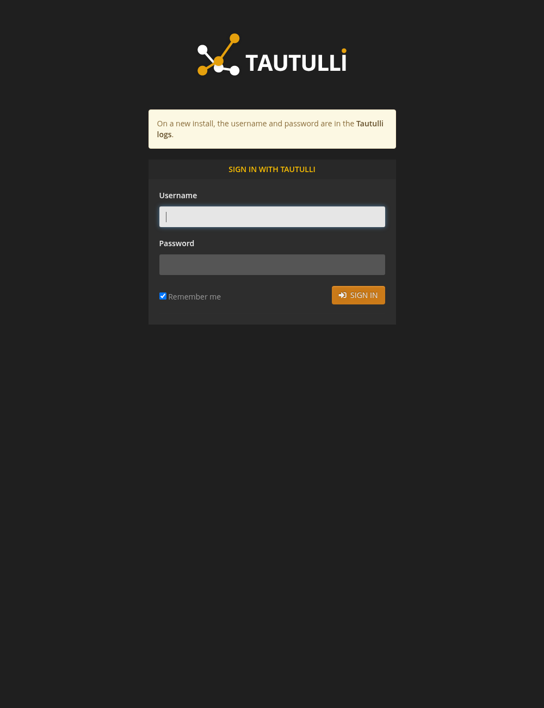

# tautulli-for-tos

> TerraMaster TOS 7 App Center — **Docker application** package for
> [Tautulli](https://github.com/linuxserver/docker-tautulli).

Tautulli is a monitoring and statistics companion for Plex Media Server: play
history, live streams, bandwidth and library statistics, and notifications.
This package runs the official LinuxServer.io image as a non-root container with
an empty capability set, and adds a small wrapper that generates the first-login
password at install time instead of shipping one.



## What this is

A four-file TOS Docker application archive (`tautullidocker.tar.gz`) that installs
Tautulli on TOS 7 through the App Center:

- `config.ini` — TOS application metadata (`application_type: docker`, id `tautullidocker`)
- `tautullidocker.lang` — 23-language superset (TOS requires 14)
- `tautullidocker.svg` — application icon (1724 bytes, 4 SVG elements)
- `docker-compose.yml` — one service, image `linuxserver/tautulli:v2.19.1-ls252`

## How it works

| | |
|---|---|
| Container image | `linuxserver/tautulli:v2.19.1-ls252` (Docker Hub, used unmodified) |
| Open | `http://<NAS-IP>:8015/` (container port 8181) |
| Runs as | non-root, `user: "1000:1000"`, `cap_drop: [ALL]`, `no-new-privileges` |
| Persistent data | `/config` → `/Volume1/DockerAppData/tautullidocker/config` |
| Logs | `docker logs tautullidocker` (stdout/stderr) and `config/logs/` |

`config` holds `config.ini`, `tautulli.db`, the first-login password file, the
logs and the cache; copying it is a complete backup.

## First login

No password is shipped in the package. On the very first start the wrapper
(`src/entrypoint.sh`) generates a random password with the same PBKDF2 parameters
Tautulli uses, stores **only the hash** in `config/config.ini`, and writes the
plain text here:

```text
/Volume1/DockerAppData/tautullidocker/config/initial-password.txt    (mode 600)
```

Open that file from the TOS file manager (**File Manager →
DockerAppData → tautullidocker → config**), sign in with the username printed
there (default `tautulli`), change the password in **Settings → Web Interface →
Authentication**, and delete the file. It is also removed automatically on the
next start once the stored hash no longer matches it.

Then complete the setup wizard with your Plex server URL and token.

## Design highlights

- **No shipped credential (S6).** The package contains no account and prints no
  secret to the log. The first-login password is generated at install time and
  written `600` inside the app data folder; Tautulli's own “random password in
  the container log” path is never used because a password already exists.
- **Least privilege (S11 / V1).** `user: "1000:1000"` plus `cap_drop: [ALL]` and
  `security_opt: [no-new-privileges:true]`; measured inside the running
  container: uid 1000, `CapEff 0`, `CapBnd 0`, `NoNewPrivs 1`. The analysis for
  the review items is in [docs/ROOT-PRIVILEGE.md](docs/ROOT-PRIVILEGE.md).
- **Private data directory (S11).** The wrapper runs with `umask 077`, sets
  `/config` and its sub-directories to `700`, and pre-creates `tautulli.db` as
  `600` so the database is not world-readable on the first start either.
- **Privacy.** The package sends no telemetry; the only outbound connection is
  the Plex server you configure (plus Tautulli's optional upstream update check).
  See [PRIVACY.md](PRIVACY.md); the package Help field also points to it.
- **One volume.** The database, settings, logs and cache are all below
  `/config`; no other host path is written.
- **Health check** probes the web UI on container port 8181 (a redirect to the
  login page counts as healthy).
- **Deterministic build**: GNU tar with uid/gid 0 and zeroed timestamps, gzip
  without a timestamp, plus the review-standards self-check below.

## Privacy

The package collects nothing and shares nothing. Tautulli stores the Plex URL,
Plex token and its play-history database locally under
`/Volume1/DockerAppData/tautullidocker/`, readable only by the application user.

The full policy is in [PRIVACY.md](PRIVACY.md), which is also the URL in the
package's `help` field. It covers what is stored on the NAS, what leaves it,
retention, your rights, security measures and the deletion channel, and it
includes the **third-party API disclosure table** required by App Center review
code C8:

| Service | Data sent | Region |
|---|---|---|
| Your Plex Media Server | Plex token, API queries | your own host |
| plex.tv | Plex account/server identifiers | United States |
| The Movie Database (TMDB) | title names and external IDs | United States |
| TheTVDB | series names and external IDs | United States |
| GitHub | version check request (no personal data) | United States |
| Notification services (Discord, Slack, Telegram, Pushover, Gotify, ntfy, SMTP, webhooks) | notification text | provider-dependent / your own host |
| Image hosting (Imgur, Cloudinary) | notification image | United States |

Only the Plex connection is part of normal operation; every other endpoint is
contacted only when you enable or configure that feature. The publisher operates
no server and receives no telemetry.

## Security

- The service runs as the unprivileged `1000:1000`; `docker exec tautullidocker
  id -u` reports 1000 on hardware.
- All Linux capabilities are dropped (`CapBnd 0000000000000000`) and
  `no-new-privileges` is set, so neither the process nor a setuid helper inside
  the image can gain privileges.
- Only one host port is published; there is no `privileged`, host network,
  Docker socket, `cap_add` or device mapping.
- The upstream LinuxServer.io image declares no `USER` (its s6 overlay starts as
  root and then drops to `PUID`/`PGID`), so the *image metadata* still looks
  root-owned to a static scanner. The package pins the runtime user and the
  capability set; `docs/ROOT-PRIVILEGE.md` documents the measurement and why no
  root exemption is requested.
- Data is confined to `DockerAppData/tautullidocker`; no host paths outside it
  are written, and the data directory is `700` with `600` credential/history
  files.

## Repository layout

```text
src/                     package sources (config.ini, .lang, .svg, compose, entrypoint.sh)
scripts/build.sh         single-architecture build + self-check
scripts/build-dual.sh    x86_64 + aarch64 build (release)
tools/verify.py          review-standards self-check
test/smoke.sh            functional smoke test (login -> dashboard -> settings, API guard)
smoke.yml                extra probes for the pipeline's smoke.py gate
test/install-and-verify.sh  on-device E2E (official installer)
docs/ROOT-PRIVILEGE.md   S11/V1 analysis: runtime user, capabilities, measurements
screenshots/             first-run screenshot
PRIVACY.md               privacy policy
README.md                this file
LICENSE                  MIT for the packaging code; upstream notices
CHANGELOG.md             release notes
tosapp.json              package spec used by the build
TOSAppSelfTestingTool    official TerraMaster self-test binary
```

## Runtime file manifest

Everything the application writes on the NAS lives inside its own data
directory; the container-internal `/tmp` is discarded with the container. The
table lists what is created and how it behaves. Nothing else is written.

| Path | Purpose | Created when | Growth bound | Lifecycle |
|---|---|---|---|---|
| `config/config.ini` | database path, Plex connection, admin credentials (hash only) and UI settings | first start | small | preserved; the user's changes survive restarts |
| `config/initial-password.txt` | plain-text first-login password (mode 600) | first start | one small file | delete after changing the password; removed automatically on the next restart |
| `config/tautulli.db` | play history, library and user statistics (SQLite) | first start | grows with the history | never overwritten; back it up |
| `config/logs` | Tautulli logs (mode 600 files in a 700 directory) | first start | rotated by Tautulli | safe to delete |
| `config/cache` | image and metadata cache | on demand | grows with the library, safe to delete | rebuilt automatically |
| `/Volume1/DockerAppData/tautullidocker/config` | all of the above (the only host path written) | on first start | bounded by your own data | persistent; kept on uninstall unless you ask to delete it |

## Architectures

The TOS store takes one package per architecture. This release provides both,
built from the same sources by `scripts/build-dual.sh`:

| Architecture | Package | Size | SHA-256 |
|---|---|---|---|
| x86_64 | `tautullidocker_x86_64.tar.gz` | 8257 B | `a7569a79e27834ebbe1f9f16efa74a7cf1e78dd311e0f2de7984d21facc9040d` |
| aarch64 | `tautullidocker_aarch64.tar.gz` | 8257 B | `866ca050a3ff0e46b31d6515302fbfe38e120303cf156ec255f8378e629a894d` |

Both packages pass the official `TOSAppSelfTestingTool -c` check. The x86_64
package also passes the isolated staging run (container running/healthy, HTTP
303, uid 1000, empty capability set) and the functional smoke test; no ARM host
was available for a container run of the aarch64 package, which is covered by
the official check and the platform's automated validation.

## Build

```bash
scripts/build-dual.sh 2.19.1-3     # both architectures, suffix-named + .sha256
scripts/build.sh 2.19.1-3          # single-architecture iteration bump
scripts/build.sh 2.19.1-3 aarch64
```

The build stages the four files, substitutes the version/platform placeholders,
embeds `src/entrypoint.sh` into the compose file (escaping every `$` as `$$`),
removes CRLF/BOM/AppleDouble, then runs `tools/verify.py`, a review-standards
self-check (archive layout, JSON validity, required fields, 14+ language
coverage, version consistency, Docker-Hub-only images, fixed tag,
reserved/recommended host ports, non-root user, per-service
healthcheck/TZ/restart, data path below the application data root, never the
`/Volume*` wildcard, comment-free sequence blocks, `x-app-meta` position, no
literal secrets and the SVG size/element limits).

## Local verification

```bash
./TOSAppSelfTestingTool -c out/tautullidocker_x86_64.tar.gz -l zh-cn
./TOSAppSelfTestingTool -c out/tautullidocker_aarch64.tar.gz -l zh-cn
bash test/smoke.sh http://127.0.0.1:8015     # against a running instance
```

`test/smoke.sh` performs the real core flow: it loads the login page, reads the
generated first-login credential from `config/initial-password.txt` (or takes
`TAUTULLI_PASSWORD`), signs in, asserts that the dashboard and the settings page
render, that the JSON API refuses requests without an API key, and that a wrong
password is rejected. Exit code 0 means usable; any non-zero means the app is
broken.

> Docker applications cannot be side-loaded through the App Center's manual
> install page (it accepts `.deb` only); the official self-testing tool's `-i`
> mode or `docker compose` are the only ways to install one for testing.

## Uninstall and data

Uninstalling without data removal keeps `/Volume1/DockerAppData/tautullidocker`
so a reinstall can reuse the history and settings. Choose data removal in the
App Center to delete it. No files are written outside that folder.

## Store submission

1. Public GitHub repo (code + README + PRIVACY + docs).
2. Release **tag `v2.19.1-3`**, assets `tautullidocker_x86_64.tar.gz` and
   `tautullidocker_aarch64.tar.gz` (each with a `.sha256`); the unsuffixed
   `tautullidocker.tar.gz` is the x86_64 package.
3. Developer platform → two App records with the same ID `tautullidocker`
   (package type Docker, same repository URL): architecture `x86_64` and
   architecture `aarch64`; each record gets its own version and asset URL.
4. Version Management → Add Version `2.19.1-3` for **each** record → automated
   validation → review.

## License / branding

Tautulli is distributed by its upstream authors under **GPL-3.0-only**. The
container image is the official image from Docker Hub
(`linuxserver/tautulli:v2.19.1-ls252`) and is used unmodified; no upstream source
code is redistributed here. This packaging is an independent community submission
by Moechz and is not affiliated with the upstream project or TerraMaster.

## Limitations

- Tautulli is a companion for an existing Plex Media Server; without Plex the web
  UI, settings, logs and notification configuration work, but there are no
  statistics.
- The first password is generated at install time and stored in plain text (mode
  600) in `config/initial-password.txt`; change it at the first login.
- The page is plain HTTP on the LAN; use a TLS reverse proxy before exposing it
  to the internet.
- Uninstalling without data removal keeps the data folder for reinstall; choose
  data removal to delete it.
- Docker applications cannot be upgraded in place in the App Center: updating
  means uninstalling and reinstalling, which keeps the data folder.

---

Packaged for TOS 7 by Moechz. Upstream image used unmodified from Docker Hub.
