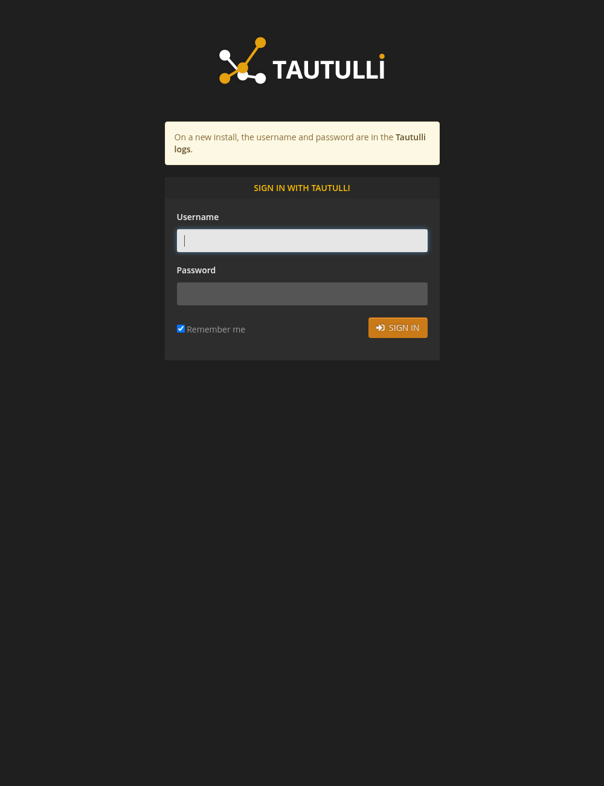

# tautulli-for-tos

> TerraMaster TOS 7 App Center — **Docker application** package for
> [Tautulli](https://github.com/linuxserver/docker-tautulli).

Tautulli is a monitoring and statistics companion for Plex Media Server: play
history, live streams, bandwidth and library statistics, and notifications.
This package runs the official LinuxServer.io image as a non-root container and
adds a first-run wrapper so the login page is usable immediately.



## What this is

A four-file TOS Docker application archive (`tautullidocker.tar.gz`) that installs
Tautulli on TOS 7 through the App Center:

- `config.ini` — TOS application metadata (`application_type: docker`, id `tautullidocker`)
- `tautullidocker.lang` — 23-language superset (TOS requires 14)
- `tautullidocker.svg` — application icon (1724 bytes, 4 SVG elements)
- `docker-compose.yml` — one service, image `linuxserver/tautulli:v2.19.1-ls252`

## How it works

| | |
|---|---|
| Container image | `linuxserver/tautulli:v2.19.1-ls252` (Docker Hub, used unmodified) |
| Open | `http://<NAS-IP>:8015/` (container port 8181) |
| Runs as | non-root, `user: "1000:1000"` (first-run wrapper execs the upstream `/init`) |
| Persistent data | `/config` → `/Volume1/DockerAppData/tautullidocker/config` |
| Logs | `docker logs tautullidocker` (stdout/stderr) |

`config` holds `config.ini`, `tautulli.db`, the logs and the cache; copying it is
a complete backup.

## First login

Tautulli 2.19 generates a random admin password on a fresh install and prints it
only in `/config/logs/tautulli.log`, which is not reachable from the App Center.
This package's wrapper seeds a known initial account before the upstream s6 init
starts:

- **Username:** `admin`
- **Password:** `tautulli`

Change it immediately in **Settings → Web Interface → Authentication**, then
complete the setup wizard with your Plex server URL and token.

## Design highlights

- **Known first login (wrapper).** `src/entrypoint.sh` writes
  `/config/config.ini` with the initial admin account on first start, then
  `exec /init` so the image's own s6 supervision and migrations still run. Later
  starts leave the user's config untouched.
- **Non-root.** `user: "1000:1000"`; verified on real hardware (the container
  reports uid 1000). No `privileged`, no `network_mode: host`, no Docker socket,
  no `cap_add`.
- **Privacy.** The package sends no telemetry; the only outbound connection is
  the Plex server you configure (plus Tautulli's optional upstream update check).
  See [PRIVACY.md](PRIVACY.md); the package Help field also points to it.
- **One volume.** The database, settings, logs and cache are all below
  `/config`; no other host path is written.
- **Health check** probes the web UI on container port 8181 (a redirect to the
  login page counts as healthy).
- **Deterministic build**: GNU tar with uid/gid 0 and zeroed timestamps, gzip
  without a timestamp, plus the review-standards self-check below.

## Privacy

The package collects nothing and shares nothing. Tautulli stores the Plex URL,
Plex token and its play-history database locally under
`/Volume1/DockerAppData/tautullidocker/`, readable only by the application user.
The full policy is in [PRIVACY.md](PRIVACY.md), which is also the URL in the
package's `help` field.

## Security

- The service runs as the unprivileged `1000:1000`; `docker exec tautullidocker
  id -u` reports 1000 on hardware.
- Only one host port is published; there is no `privileged`, host network,
  Docker socket, `cap_add` or device mapping.
- The upstream LinuxServer.io image starts s6-overlay as root internally and
  drops to its own user. This package overrides the container user, so the
  service runs as 1000. The s6 init needs to adjust `/run` permissions, so
  `no-new-privileges`/`cap_drop` cannot be added without modifying the image
  (which the store rules forbid); the non-root `user:` directive is the
  effective privilege reduction.
- Data is confined to `DockerAppData/tautullidocker`; no host paths outside it
  are written.

## Repository layout

```text
src/                     package sources (config.ini, .lang, .svg, compose, entrypoint.sh)
scripts/build.sh         single-architecture build + self-check
scripts/build-dual.sh    x86_64 + aarch64 build (release)
tools/verify.py          review-standards self-check
test/install-and-verify.sh  on-device E2E (official installer)
screenshots/             first-run screenshot
PRIVACY.md               privacy policy
README.md                this file
LICENSE                  MIT for the packaging code; upstream notices
CHANGELOG.md             release notes
tosapp.json              package spec used by the build
TOSAppSelfTestingTool    official TerraMaster self-test binary
```

## Runtime file manifest

Everything the application writes on the NAS lives inside its own data
directory; the container-internal `/tmp` is discarded with the container. The
table lists what is created and how it behaves. Nothing else is written.

| Path | Purpose | Created when | Growth bound | Lifecycle |
|---|---|---|---|---|
| `config/config.ini` | database path, Plex connection, admin credentials and UI settings | first start (seeded with the initial admin account) | small | preserved; the user's changes survive restarts |
| `config/tautulli.db` | play history, library and user statistics (SQLite) | first start | grows with the history | never overwritten; back it up |
| `config/logs` | Tautulli logs, including the generated password on an untouched upstream install | first start | rotated by Tautulli | safe to delete |
| `config/cache` | image and metadata cache | on demand | grows with the library, safe to delete | rebuilt automatically |
| `/Volume1/DockerAppData/tautullidocker/config` | all of the above (the only host path written) | on first start | bounded by your own data | persistent; kept on uninstall unless you ask to delete it |

## Architectures

The TOS store takes one package per architecture. This release provides both,
built from the same sources by `scripts/build-dual.sh`:

| Architecture | Package | Size | SHA-256 |
|---|---|---|---|
| x86_64 | `tautullidocker_x86_64.tar.gz` | 5896 B | `0edc38ce90af445842490cc20bebc05a63373d3f896aa097d1cc5f5c89ca9b5e` |
| aarch64 | `tautullidocker_aarch64.tar.gz` | 5897 B | `f844f4abe446c25a003e2617181a88d95187c9ef533b53dc88fa6362a36b6a98` |

The x86_64 package was verified with the full on-device E2E; the aarch64 package
passes the official `TOSAppSelfTestingTool -c` check and the developer platform's
automated validation (no ARM host was available for a container E2E).

## Build

```bash
scripts/build-dual.sh 2.19.1-1     # both architectures, suffix-named + .sha256
scripts/build.sh 2.19.1-2          # single-architecture iteration bump
scripts/build.sh 2.19.1-1 aarch64
```

The build stages the four files, substitutes the version/platform placeholders,
embeds `src/entrypoint.sh` into the compose file (escaping every `$` as `$$`),
removes CRLF/BOM/AppleDouble, then runs `tools/verify.py`, a review-standards
self-check (archive layout, JSON validity, required fields, 14+ language
coverage, version consistency, Docker-Hub-only images, fixed tag,
reserved/recommended host ports, non-root user, per-service
healthcheck/TZ/restart, data path below the application data root, never the
`/Volume*` wildcard, comment-free sequence blocks, `x-app-meta` position, no
literal secrets and the SVG size/element limits).

## Local verification

```bash
./TOSAppSelfTestingTool -c out/tautullidocker_x86_64.tar.gz -l zh-cn
./TOSAppSelfTestingTool -c out/tautullidocker_aarch64.tar.gz -l zh-cn
bash test/install-and-verify.sh out/tautullidocker_x86_64.tar.gz
```

> Docker applications cannot be side-loaded through the App Center's manual
> install page (it accepts `.deb` only); the official self-testing tool's `-i`
> mode or `docker compose` are the only ways to install one for testing.

## Uninstall and data

Uninstalling without data removal keeps `/Volume1/DockerAppData/tautullidocker`
so a reinstall can reuse the history and settings. Choose data removal in the
App Center to delete it. No files are written outside that folder.

## Store submission

1. Public GitHub repo (code + README + PRIVACY).
2. Release **tag `v2.19.1-1`**, assets `tautullidocker_x86_64.tar.gz` and
   `tautullidocker_aarch64.tar.gz` (each with a `.sha256`); the unsuffixed
   `tautullidocker.tar.gz` is the x86_64 package.
3. Developer platform → two App records with the same ID `tautullidocker`
   (package type Docker, same repository URL): architecture `x86_64` and
   architecture `aarch64`; each record gets its own version and asset URL.
4. Version Management → Add Version `2.19.1-1` for **each** record → automated
   validation → review.

## License / branding

Tautulli is distributed by its upstream authors under **GPL-3.0-only**. The
container image is the official image from Docker Hub
(`linuxserver/tautulli:v2.19.1-ls252`) and is used unmodified; no upstream source
code is redistributed here. This packaging is an independent community submission
by Moechz and is not affiliated with the upstream project or TerraMaster.

## Limitations

- Tautulli is a companion for an existing Plex Media Server; without Plex it only
  provides the login/setup screens and no statistics.
- The initial admin password is `tautulli`; change it immediately in Settings.
- The page is plain HTTP on the LAN; use a TLS reverse proxy before exposing it
  to the internet.
- Uninstalling without data removal keeps the data folder for reinstall; choose
  data removal to delete it.
- Docker applications cannot be upgraded in place in the App Center: updating
  means uninstalling and reinstalling, which keeps the data folder.

---

Packaged for TOS 7 by Moechz. Upstream image used unmodified from Docker Hub.
